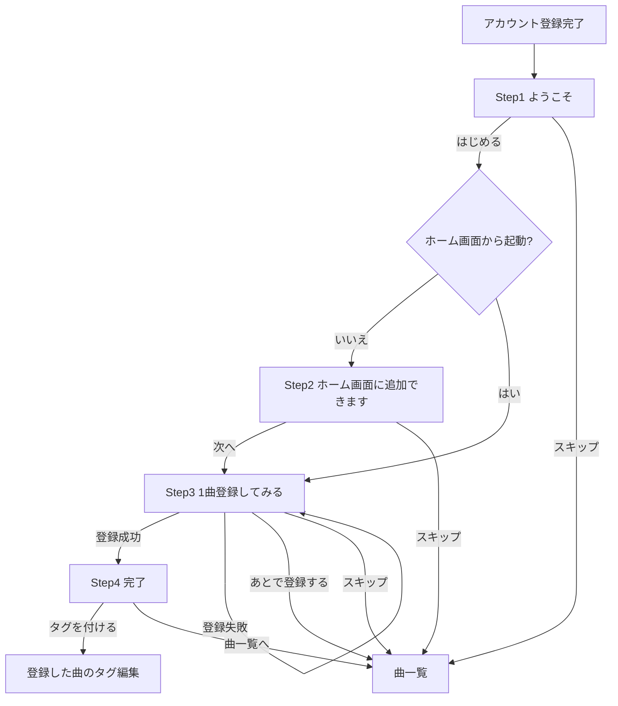
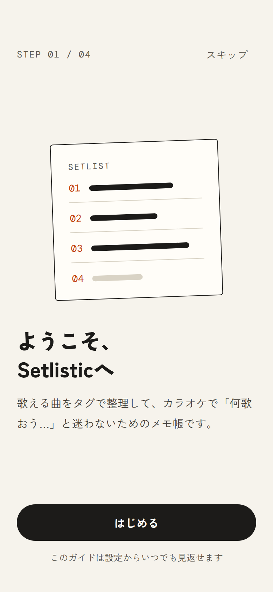
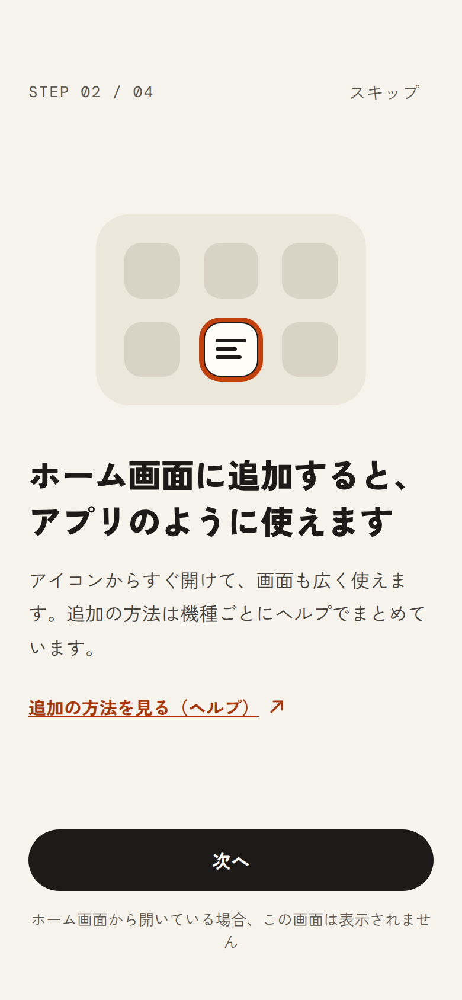
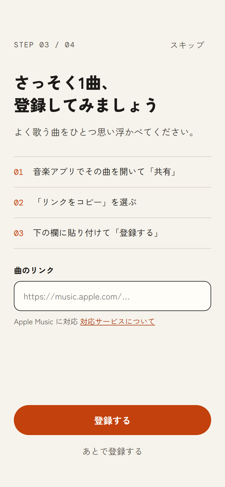
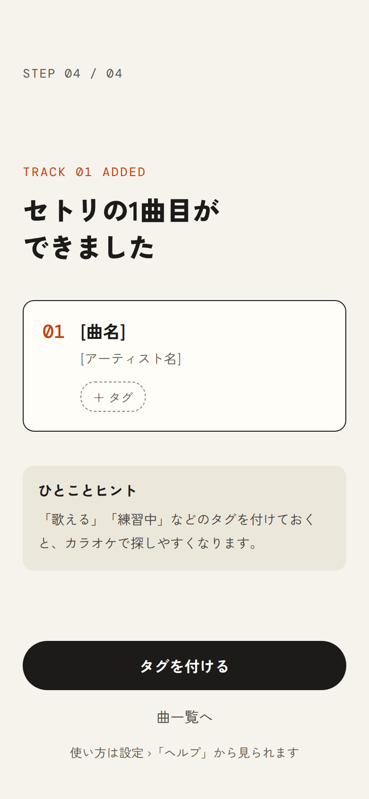

# チュートリアル実装 引き継ぎ資料（Issue #18）

対象Issue: https://github.com/Laplusdestiny/setlistic/issues/18
デザインモック: 同じフォルダの PNG 4枚（スマホ 390×844 を2倍で書き出し）。各ステップの節に画像を載せている

この資料は Setlistic の「アカウント登録直後チュートリアル」を実装するためのもの。フレームワーク・ルーティング・状態管理・コンポーネントの書き方は既存コードに合わせること。曲登録処理は既存のものを再利用し、チュートリアル用に別実装しない。

---

## 1. 目的とスコープ

アカウント登録直後のユーザーに、アプリの目的を伝え、1曲登録するところまで案内する。OSごとの細かい手順（ホーム画面追加など）はチュートリアルに載せず、ヘルプページへリンクで誘導する。

**スコープ内**
- 4ステップのチュートリアル画面と遷移
- 初回表示の判定と完了フラグの保存
- 設定画面からの再表示
- ホーム画面から起動している場合のステップ2自動スキップ

**スコープ外（別Issue候補）**
- ヘルプページ本体（内容案は Issue #18 のコメント参照）
- ブラウザ表示時に出す「ホーム画面に追加」バナー
- Android の `beforeinstallprompt` を使ったインストールボタン
- タグ・検索・ランダムの紹介（ヘルプ側で扱う）

---

## 2. 表示条件と状態管理

- アカウント登録完了後、最初の画面遷移でチュートリアルを表示する
- 完了判定は端末ではなくアカウント単位で持つ（PCとスマホで二重表示しないため）
  - 例: Supabase の `profiles` テーブルに `tutorial_completed_at timestamptz null` を追加
  - 既存ユーザーはマイグレーションで現在時刻を入れておき、表示されないようにする
- 次のいずれかでフラグを保存し、以後は自動表示しない
  - ステップ4に到達
  - 任意のステップで「スキップ」
  - ステップ3で「あとで登録する」
- 設定画面に「チュートリアルをもう一度見る」を追加。再表示時はフラグを変更しない

---

## 3. 遷移仕様



**ホーム画面から起動しているかの判定**

```js
const isStandalone =
  window.matchMedia('(display-mode: standalone)').matches ||
  window.navigator.standalone === true; // iOS Safari
```

**ステップ表示（左上の `STEP 01 / 04`）**
- Step2 をスキップする場合は総数を3にして番号を詰める（`STEP 01 / 03` → `STEP 02 / 03` → `STEP 03 / 03`）
- 総数は表示開始時に一度だけ決める

**Step3 の登録処理**
- 既存の「URL貼り付け → パース → 登録」処理をそのまま呼ぶ
- 送信中はボタンを無効化してローディング表示
- 失敗時は Step3 に留まり、入力欄の下にエラーメッセージとヘルプ（対応サービス）へのリンクを表示
- 成功時は登録した曲の ID を Step4 に渡す
- 入力欄が空のときは「登録する」を無効化

**戻る操作**
- ブラウザバック／Androidの戻るで前のステップに戻れるようにする（各ステップをURLかヒストリーに反映）
- Step4 から Step3 に戻った場合、二重登録しないよう Step3 は空欄で表示する

---

## 4. 各画面の内容

文言はモックの通り。`[ ]` は動的に差し込む値。

### Step1 ようこそ



- 上部: `STEP 01 / 04` ／ 右上に「スキップ」
- イラスト: 紙のセトリ表（番号 01〜04 と横線。アイコンと同じモチーフ。少し傾ける）
- 見出し: 「ようこそ、Setlisticへ」
- 本文: 「歌える曲をタグで整理して、カラオケで「何歌おう…」と迷わないためのメモ帳です。」
- 主ボタン（黒）: 「はじめる」
- 補足: 「このガイドは設定からいつでも見返せます」

### Step2 ホーム画面に追加できます



- 上部: `STEP 02 / 04` ／ 「スキップ」
- イラスト: ホーム画面のアイコングリッド。Setlistic のアイコンだけ強調色の枠
- 見出し: 「ホーム画面に追加すると、アプリのように使えます」
- 本文: 「アイコンからすぐ開けて、画面も広く使えます。追加の方法は機種ごとにヘルプでまとめています。」
- リンク: 「追加の方法を見る（ヘルプ）」→ ヘルプのホーム画面追加セクション（別タブ）
- 主ボタン（黒）: 「次へ」
- 補足: なし（モックの補足文は開発メモなので実装しない）

### Step3 1曲登録してみる



- 上部: `STEP 03 / 04` ／ 「スキップ」
- 見出し: 「さっそく1曲、登録してみましょう」
- 本文: 「よく歌う曲をひとつ思い浮かべてください。」
- 手順（番号付き、共通文言）
  1. 音楽アプリでその曲を開いて「共有」
  2. 「リンクをコピー」を選ぶ
  3. 下の欄に貼り付けて「登録する」
- 入力欄ラベル: 「曲のリンク」、`type="url"`、プレースホルダー `https://music.apple.com/…`
- 入力欄下の補足: 「[対応サービス名] に対応」＋リンク「対応サービスについて」
  - 現時点で確定しているのは Apple Music のみ。対応サービス一覧は定数か設定から生成し、ハードコードしない
- 主ボタン（強調色）: 「登録する」
- 副ボタン（テキスト）: 「あとで登録する」

### Step4 完了



- 上部: `STEP 04 / 04`（スキップなし）
- ラベル: `TRACK 01 ADDED`
- 見出し: 「セトリの1曲目ができました」
- 登録した曲のカード: 番号 `01`、[曲名]、[アーティスト名]、破線の「＋ タグ」チップ（タップでタグ編集へ）
- ヒント: 「ひとことヒント」「「歌える」「練習中」などのタグを付けておくと、カラオケで探しやすくなります。」
- 主ボタン（黒）: 「タグを付ける」→ 登録した曲のタグ編集
- 副リンク: 「曲一覧へ」
- 補足: 「使い方は設定 ›「ヘルプ」から見られます」

---

## 5. デザイン仕様

モックから抜き出した値。既存のデザイントークンがあればそちらを優先し、近い値に寄せる。

**色**
| 用途 | 値 |
|---|---|
| 背景（生成り） | `#F6F3EC` |
| カード・入力欄の面 | `#FFFDF8` |
| サブ面（ヒント枠など） | `#ECE7DB` |
| 文字（インク） | `#1C1B19` |
| 本文 | `#45423C` |
| 補足・ステップ表示 | `#5C5850` |
| 罫線 | `#D9D3C5` |
| 強調色 | `#C2410C`（白文字で使用） |
| 強調色のリンク文字 | `#A8370A` |

**フォント**
- 本文・見出し: Zen Kaku Gothic New（400 / 500 / 700 / 900）、フォールバック `'Hiragino Sans', 'Noto Sans JP', sans-serif`
- ステップ番号・セトリ番号: DM Mono（400 / 500）、フォールバック `ui-monospace, monospace`

**サイズ・余白**
- 画面余白: 上 56px／左右 24px／下 40px（セーフエリアを加算）
- 見出し: 28〜30px / weight 900 / 行間 1.35〜1.4
- 本文: 16px / 行間 1.8、補足: 13px
- 主ボタン: 高さ 52px、角丸 26px（ピル形）、全幅
- テキストボタン・リンク: タップ領域 高さ 44px 以上
- 入力欄: 高さ 52px、枠 1.5px `#1C1B19`、角丸 12px
- カード: 枠 1.5px `#1C1B19`、角丸 12px、内側 20px

**レイアウト**
- 縦3段: 上部バー（ステップ表示＋スキップ）／中央コンテンツ（縦中央寄せ。Step3 のみ上寄せ）／下部アクション
- PC: 画面中央に最大幅 420px 程度のカード、またはモーダルとして同じ内容を表示（3ペインの上に重ねる）
- ダークモード対応が既存にあれば、同じ方針で色を差し替える

---

## 6. アクセシビリティ

- 各ステップ表示時に見出しへフォーカスを移す
- ステップ表示は `aria-label="ステップ 1 / 4"` 等で読み上げ可能にする
- イラストは装飾扱い（`aria-hidden="true"`）
- エラーメッセージは `aria-live="polite"` で通知
- `prefers-reduced-motion` のときは画面切り替えのアニメーションを無効化

---

## 7. 受け入れ条件

- [ ] 新規アカウント登録直後にチュートリアルが表示される
- [ ] 既存ユーザーには表示されない
- [ ] スキップ・あとで登録する・Step4到達のいずれかで、以後自動表示されない
- [ ] 別端末でログインしても再表示されない
- [ ] 設定画面から再表示でき、再表示してもフラグは変わらない
- [ ] ホーム画面から起動しているとき Step2 が表示されず、ステップ番号が詰まる
- [ ] Step3 で有効なURLを登録すると Step4 に進み、曲名とアーティストが表示される
- [ ] Step3 で無効なURLのときエラーとヘルプへのリンクが出て、Step3 に留まる
- [ ] Step4 の「タグを付ける」で登録した曲のタグ編集が開く
- [ ] ブラウザバックで前のステップに戻れ、二重登録が起きない
- [ ] スマホ・PCの両方で崩れずに表示される

---

## 8. 未決事項（実装時はプレースホルダーで進めてよい）

- ヘルプページのURL（定数化しておき、確定後に差し替え）
- 正式対応する音楽サービスの一覧（Apple Music 以外は検討中）
- 設定画面内での「チュートリアルをもう一度見る」の配置

---

## 9. 同梱ファイル

- `README.md`（この資料）
- `tutorial-step1-welcome.png` / `tutorial-step2-home.png` / `tutorial-step3-register.png` / `tutorial-step4-done.png`

リポジトリでは `docs/tutorial/` などにフォルダごと置く想定。
